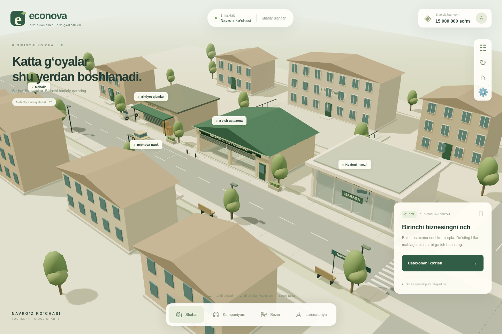

# Econova · First playable street (P0)

A shared Uzbek economics game in a navigable 3D street. Two players found and run an auto repair business; a third player can acquire it. This is a **local practice pilot with three explicit test accounts**, not a published school service.



## Windows: open the game

1. Install **Node.js 24 or later** from https://nodejs.org/en/download.
2. Download the repository ZIP and choose **Extract all**.
3. In the extracted folder, double-click **START_ECONOVA.cmd**.
4. The launcher starts the server and opens the browser. The 3D library is included in the ZIP; no npm installation or internet connection is needed after Node.js is installed. Keep its console open. Ctrl+C stops it.

Opening `index.html` directly shows these instructions and a link to the preserved old game. The new shared economy requires the server.

## Terminal

```sh
node server.js
```

Open `http://localhost:3000`. The default bind is `127.0.0.1`. `PORT` changes the port; `ECONOVA_DB` selects the database path. The default database is `data/econova.sqlite`, ignored by Git. Node 24 includes the SQLite runtime; a separate database installation is unnecessary. The verified Three.js files and MIT license are bundled in `public/vendor/`; no external API or LLM credential is required.

Use the existing checkout. Cloud tasks are isolated; do not create a worktree unless requested.

## Try the P0 story

Use three different browser profiles, browsers, or isolated sessions. Tabs in the same profile share a login cookie. For a solo walkthrough, use **Shaxsiy hamyon → Boshqa ishtirokchi sifatida kirish** to switch accounts.

| Login | Role | Password | Initial wallet |
|---|---|---|---:|
| aziza | Founder A | econova-demo | 15,000,000 |
| bekzod | Founder B | econova-demo | 15,000,000 |
| camila | Buyer C | econova-demo | 15,000,000 |

All amounts are virtual so‘m; these accounts exist only for this local practice city.

1. **Aziza:** open the workshop; propose 6m from yourself and 4m from Bekzod. Your 6m is reserved immediately.
2. **Bekzod:** enter the same city and sign the same proposal. One company receives 10m with 60/40 ownership. A cancelled or expired proposal returns all reserved funds.
3. **Aziza:** lease the two-bay workshop (200k initial rent), install two lifts (600k equipment), hire Saida, Rustam and Dilshod, buy six parts kits (360k), and keep the service price at 200k.
4. Accept the first six practice bookings. One lift breaks: available capacity is three jobs. Compare renting a temporary lift (180k) with postponing three bookings.
5. Rent the temporary lift and use **Mashq smenasini hozir yakunlash**. Six jobs complete; revenue is 1.2m, operating profit is 150k, and cash is 9.4m. Without the temporary lift, three jobs complete and operating profit is 30k. The difference is 120k.
6. **Aziza:** list the business for 12m in **Sotuv**. **Bekzod:** sign the same sale terms.
7. **Camila:** inspect the disclosure in **Bozor**, then acquire the company. Aziza receives 7.2m and Bekzod 4.8m. Camila owns the same company, including its cash, equipment, staff, stock, accepted orders, and recorded obligations. Former owners lose operational access.

The street shows booked cars and completed jobs from server state. Rotate the camera 180° to inspect actual rear geometry. The **Joylar** list exposes the same actions if WebGL is unavailable. Low graphics and reduced-motion settings are available.

## Persistence, transactions, and time

- SQLite transactions commit command receipts, the shared city snapshot, account changes, and balanced journal lines together. Command IDs deduplicate retries; a reused ID with different payload is rejected.
- Versions reject stale proposals or purchases. Founder reservations and purchase payouts are atomic. Only authenticated owners can access private company data or operate it. Sale disclosures are deliberately shared with potential buyers.
- Every ledger entry balances; journal records cannot be updated or deleted through the database. Money is safe integer virtual so‘m, shares are integer basis points. Operational profit excludes grants and capital contributions; equipment purchase, depreciation, inventory and consumed parts are separately recorded.
- HTTP-only login sessions persist in SQLite. Server-sent events carry invalidations only; clients fetch their own authorized view. Reconnect and refresh do not create grants, bookings, or settlements.
- A server timer settles due shifts while browsers are closed. P0 uses a documented practice mapping: one shift every three real hours while the server is running. The visible practice action advances one shift immediately. The school calendar, quiet hours, inactive-manager mode and general simulation clock belong to P1.
- The server must remain running to process time continuously. A stopped server resumes due work after restart. P0 is a finite six-booking scenario, not an endless demand simulation.

## Development and tests

```sh
npm ci
npm test
npx playwright install chromium
npm run test:browser
```

On Linux the browser test uses `/usr/bin/chromium` if available; `CHROMIUM_PATH` can select an installed browser. On Windows/macOS it uses Playwright's installed Chromium. The browser suite creates an isolated temporary database and three independent contexts; it does not touch your saved city. Captures and a JSON report are generated in `test-results/`.

Development dependencies are only needed to run the browser tests or refresh the bundled library. `public/vendor/manifest.json` records the pinned package archive integrity and each bundled file hash.

See [P0 validation](docs/P0_VALIDATION.md) for observed results and [architecture](docs/ARCHITECTURE.md) for scope and invariants.

## Existing prototype and data

The original game is preserved in `legacy/` and served at `/legacy/`. Its `econova-v1` localStorage key is never cleared or converted into authoritative balances. Browser storage belongs to its original browser/origin; file-based URLs may have separate storage. Keep your previous extracted folder if you want to retain its exact file URL. The root launch page can export `econova-v1` when it is present at that URL. The new city uses SQLite and starts with explicitly separate practice balances. Do not delete `data/` when updating the project.

## Limits of this P0 release

- The three local accounts use documented demo credentials. This build binds to loopback by default and is not intended for public hosting. Production school roster verification, Telegram `initData` authentication, HTTPS deployment and administration are not connected.
- There is one operating repair company and one reservable workshop. Subcontracting unlocks only when a second student-operated workshop exists; it is not simulated as a fake accepted deal here.
- The six booking customers have funded accounts and fixed accepted prices. The full 2,000-resident preference, competition and income simulation, 35 sectors, 36 building designs and join-driven city growth are later phases.
- The bank and expansion buildings clearly show later-phase availability. No live AI provider is connected; Uzbek explanations are derived from fixed rules and recorded state. Normal P0 gameplay has no LLM dependency.
- Art is original procedural geometry with simplified materials. Phone viewport behavior is checked; real-device Telegram behavior and device FPS are not yet measured.

The product direction and phased scope are recorded in [PRODUCT_SCOPE.md](docs/PRODUCT_SCOPE.md). P0 is the first working part, not a claim that the entire specification is implemented.
